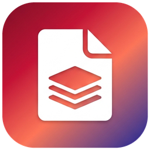

<div align="center">
  
  <h1>PDF Optimize &amp; Dönüştürme Aracı (<code>pdf-optimizer-rs</code>)</h1>
  <p><strong>Rust + egui + PDFium</strong> ile geliştirilmiş; ultra hafif (~11 MB), çok hızlı, modern arayüzlü masaüstü PDF birleştirme, sıkıştırma ve görsel dönüştürme aracı.</p>
</div>

---

## Özellikler

- **Birleştir ve PDF Olarak Kaydet (Rasterize / Vektör→Görsel Sıkıştırma)**
  - AutoCAD / mimari paftalar gibi binlerce vektör içeren ağır PDF'leri seçilen **DPI** (`72`, `96`, `150`, `200`, `300`) ve **JPEG Kalitesi** (`%10 – %100`) ile doğrudan `/DCTDecode` akışı olarak yeni PDF'e gömer.
  - PNG ve JPEG dosyalarını sayfa sırasına uygun olarak PDF içine ekler (saydam PNG arka planlarını otomatik beyaz zeminle birleştirir).
- **Kayıpsız PDF Birleştirme**
  - Rasterize seçeneği kapatıldığında mevcut PDF sayfalarını vektör ve metin kalitesini bozmadan Chrome'un **PDFium** motoruyla birleştirir.
- **Toplu PDF → JPG / PNG Dışa Aktarma**
  - Listedeki PDF dosyalarının tüm sayfalarını seçilen DPI'da ve `rayon` çoklu çekirdek paralelliğiyle `<dosya_adi>_sayfa_<no>.jpg` veya `.png` olarak kaydeder.
- **Modern & Akıcı Arayüz**
  - Açık / Koyu tema geçişi, pencere geneli **Sürükle-Bırak** desteği, sıralama kontrolleri (`▲`, `▼`, `✕`), arka plan iş parçacığı ile donmayan arayüz, canlı ilerleme çubuğu, **İptal** ve işlem sonunda boyut kazancı özeti (`İlk Boyut → Son Boyut (-%XX)`).

## Hazır Windows Sürümü

Kurulum gerektirmez. [Releases](../../releases) sayfasından `pdf-optimizer-rs-v2.0.0-win64.zip` arşivini indirip bir klasöre çıkarın ve `pdf_araci.exe` dosyasını çalıştırın (`pdfium.dll` aynı klasörde bulunmalıdır).

## Kaynaktan Derleme (Windows)

### Gereksinimler
- [Rust](https://rustup.rs/) (`1.85+` / `edition 2021`)
- `pdfium.dll` ([bblanchon/pdfium-binaries](https://github.com/bblanchon/pdfium-binaries/releases/latest) üzerinden `pdfium-win-x64.tgz` indirip `bin/pdfium.dll` dosyasını proje köküne / `target/release/` yanına koyun)

### Test ve Release Derleme
```powershell
# PDFium DLL'i indirme (PowerShell)
Invoke-WebRequest -Uri "https://github.com/bblanchon/pdfium-binaries/releases/latest/download/pdfium-win-x64.tgz" -OutFile pdfium.tgz
tar -xzf pdfium.tgz bin/pdfium.dll
Move-Item -Force bin/pdfium.dll pdfium.dll
Remove-Item -Recurse -Force bin, pdfium.tgz

# Testler ve release derleme
cargo test --release
cargo build --release
```

> **Not (Windows GNU / LLVM-MinGW):** Yerel `x86_64-pc-windows-gnu` veya `x86_64-pc-windows-gnullvm` araç zinciriniz varsa `.exe` ikonu `windres` + `build.rs` ile otomatik olarak gömülür.

## Teknoloji Yığını
- **Arayüz:** `eframe` / `egui`
- **PDF Motoru:** `pdfium-render` + resmi `pdfium.dll`
- **Paralel Kodlama:** `rayon`, `jpeg-encoder`, `image`
- **Dosya Diyalogları:** `rfd`

## Lisans
[MIT](LICENSE)
